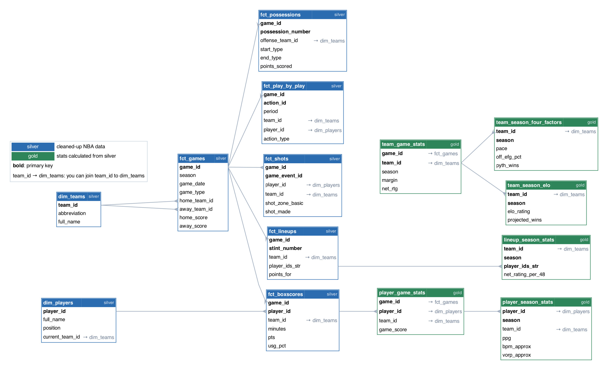

# NBA Analytics DuckDB

Pull NBA stats and game history into a local DuckDB database.

The data includes:
- per-game and per-season player and team stats
- box plus-minus (BPM) and VORP
- four factors, pace and Elo ratings for teams
- shot quality: actual vs. expected FG% by zone
- lineup and on/off numbers, clutch splits, play types

Schedules, box scores, play-by-play, shot charts, and other data are pulled from public NBA stats endpoints. 
Note: This project is not affiliated with the NBA. No NBA data lives in this repo.

## Installation

You need Python 3.11+ and [uv](https://docs.astral.sh/uv/).

    git clone https://github.com/azhangd/nba-analytics-duckdb.git
    cd nba-analytics-duckdb
    make install-live

## Loading data

    uv run nba-duckdb run-live --season 2026-27

The client sends about one request/sec per run to NBA endpoints (set `NBA_DUCKDB_NBA_API_RATE_PER_SECOND` to change it), so it takes a while. Data is downloaded to `data/warehouse/nba.duckdb`.

To load only part of a season:

    # One or more teams' games (team ids, e.g. LAL and SAS)
    uv run nba-duckdb run-live --season 2026-27 --team-ids 1610612747 1610612759

    # A date range, inclusive (YYYY-MM-DD)
    uv run nba-duckdb run-live --season 2026-27 --start-date 2026-11-01 --end-date 2026-11-15

    # Specific games, e.g. LAL at PHX and SAS at UTA (finished games only; anything else is an error)
    uv run nba-duckdb run-live --season 2026-27 --game-ids 0022600237 0022600239

    # Just the core: schedule, rosters, box scores and play-by-play
    uv run nba-duckdb run-live --season 2026-27 --quick

    # Refill one source for a season: pbp or shots
    uv run nba-duckdb backfill-source shots --season 2026-27

Filters apply to per-game data. Season-wide stats (tracking, hustle, play types) are always pulled for the whole league. With only some teams loaded, percentiles and ranks compare against whoever is in the database (see [VALIDATION.md](VALIDATION.md)).

If a run dies halfway through, `run-live --resume-latest` picks up where it
left off. Running `run-live` again later grabs any new games. If you want that
to happen every night, there are Airflow DAGs for it. See
[docs/AIRFLOW.md](docs/AIRFLOW.md).

Summer League works too: `uv run nba-duckdb run-summer-league --season 2026-27`.

## More

- [docs/SCHEMA.md](docs/SCHEMA.md) shows all the tables and how they join
- [VALIDATION.md](VALIDATION.md) covers how the metrics are calculated and where they're approximate
- `.env.example` lists the settings (database path, seasons, rate limits)
- [CONTRIBUTING.md](CONTRIBUTING.md) if you want to help out

MIT licensed.
