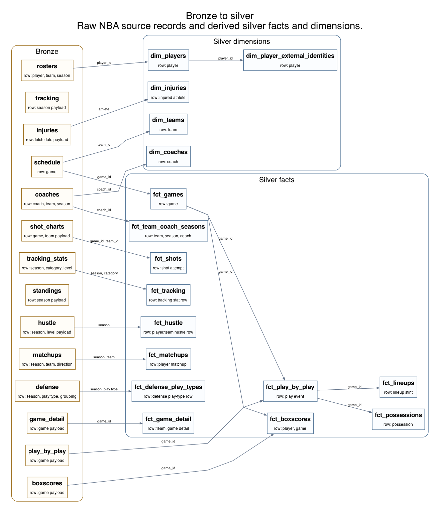

# NBA Analytics DuckDB

Build a local NBA analytics warehouse in DuckDB.

The repo includes collectors, Airflow 3 DAGs, Cosmos-rendered dbt models,
schema, quality checks, and smoke-test fixtures. It does not redistribute
official league, team, player, or game data. It is not affiliated with,
authorized by, sponsored by, or endorsed by the NBA.

## What It Does

`nba-analytics-duckdb` collects data from public NBA endpoints, stores the raw
responses, builds normalized tables, and produces player/team analysis tables in
a local DuckDB file.

`run-smoke` builds the warehouse from local fixtures, so you can test the
project without calling live APIs. `run-live` builds the warehouse from live
endpoints. `--quick` exists for short development checks.

## Setup

Requirements:

- Python 3.11+
- [uv](https://docs.astral.sh/uv/)
- Graphviz, only if you want to regenerate the PNG diagrams locally

If you do not have `uv` yet, install it from the
[official uv installation guide](https://docs.astral.sh/uv/getting-started/installation/):

```bash
curl -LsSf https://astral.sh/uv/install.sh | sh
```

Homebrew, `pipx`, and `pip` installs are also supported by the uv project. If
you prefer a regular virtual environment, this also works, though the Makefile
uses `uv`:

```bash
python -m venv .venv
source .venv/bin/activate
python -m pip install -e ".[dev]"
```

After cloning the repository:

```bash
cd nba-analytics-duckdb
make install
uv run nba-duckdb init
```

That light setup is enough for CLI work, docs, quality checks, and the quick
smoke path:

```bash
uv run nba-duckdb run-smoke --quick
```

To verify the full warehouse without calling live APIs, install the full local
pipeline dependency set and run the full smoke path:

```bash
uv sync --extra dev --extra full
uv run nba-duckdb run-smoke
make quality
```

If you only want to test live collection and the quick live graph, install the
live optional dependency set:

```bash
uv sync --extra dev --extra live
```

If you want live collection and the ML-derived tables, use the full install:

```bash
make install-full
```

To use Airflow's scheduler and UI, install the separate operational extra:

```bash
make install-airflow
make airflow-prepare
make airflow-dev
```

The local Airflow deployment starts with every DAG paused and live schedules
disabled. See [docs/AIRFLOW.md](docs/AIRFLOW.md) for the DAG inventory,
concurrency contract, scheduling configuration, and production guidance.

With a regular virtual environment, the equivalent installs are:

```bash
python -m pip install -e ".[dev,ml]"
python -m pip install -e ".[dev,live]"
python -m pip install -e ".[dev,full]"
python -m pip install -e ".[dev,full,airflow]"
```

The full smoke path uses synthetic fixtures and writes to
`data/warehouse/smoke.duckdb` by default. Quick smoke writes to
`data/warehouse/smoke-quick.duckdb` by default. Live runs use
`data/warehouse/nba.duckdb`. Keeping those files separate prevents short
development checks from overwriting full-smoke or collected NBA data.
`run-smoke` ignores live warehouse defaults from `.env`; only warehouse
variables exported in your shell are treated as an intentional override.

The full smoke graph includes dbt-built marts and ML-derived gold tables, so it
requires the `full` extra. The quick smoke graph is the lightweight contributor
check.

`make quality` checks the smoke warehouse by default so it validates the output
from `run-smoke`. To check a live warehouse directly, set `NBA_DUCKDB_PATH` or
run `uv run nba-duckdb quality` with your live configuration.

To see a small query against the warehouse, start with
[examples/basic_team_summary/analysis.py](examples/basic_team_summary/analysis.py).
After `run-smoke`, run:

```bash
uv run python examples/basic_team_summary/analysis.py
```

It reads a few gold tables and prints a team summary. The examples index is
[examples/README.md](examples/README.md).

## Run Live Data

Live collection requires the `live` extra. The quick live graph works with
`uv sync --extra dev --extra live`; the default live graph also trains or
computes ML-derived tables, so `make install-full` is the recommended setup
before a full live run.

Start with a team-scoped quick run to verify live endpoint access and core
tables:

```bash
uv run nba-duckdb run-live --quick --season 2025-26 --team-ids 1610612737
```

Then build the full warehouse for the same scope:

```bash
uv run nba-duckdb run-live --season 2025-26 --team-ids 1610612737
```

For a full loaded season, omit `--team-ids`:

```bash
uv run nba-duckdb run-live --season 2025-26
```

The default live run finishes with the quality checks. Full-season collection
can take a while and may be affected by endpoint throttling. The runner records
task state and item-level ingestion state so failed or interrupted work can be
resumed instead of restarted from scratch.

`run-live` refuses to run against a warehouse that already contains synthetic
smoke rows. Use a clean `NBA_DUCKDB_PATH` for live work.

### Run Summer League Data

Summer League uses a separate, competition-aware graph backed by the official
NBA-operated schedule, box-score, play-by-play, and shot-chart feeds. The graph
covers the California Classic (`LeagueID=13`), Las Vegas (`LeagueID=15`), and
Salt Lake City (`LeagueID=16`) competitions. NBA labels July 2026 events as
season `2026-27`, and its stats endpoints require `SeasonType=Regular Season`
alongside the Summer League ID.

Use a dedicated warehouse so experiments and competition-level claims remain
easy to audit:

```bash
NBA_DUCKDB_PATH=data/warehouse/summer-league-2026.duckdb \
  uv run nba-duckdb run-summer-league --season 2026-27
```

The default command ingests all three competitions. A bounded verification run
can target one competition and game:

```bash
NBA_DUCKDB_PATH=/tmp/summer-league.duckdb \
  uv run nba-duckdb run-summer-league \
    --season 2026-27 \
    --competitions summer_league_vegas \
    --game-ids 1522600001
```

The graph materializes `silver.summer_league_games`,
`silver.summer_league_boxscores`, `silver.summer_league_play_by_play`, and
`silver.summer_league_shots`. Its terminal quality task fails if a requested
competition is absent or if any completed game is missing a required raw or
silver fact. It intentionally does not run NBA regular-season standings,
tracking, gold, or ML tasks.

## How It Works

The warehouse has four schemas:

- `bronze`: raw source responses and source metadata.
- `silver`: normalized facts and dimensions.
- `gold`: player tables, team tables, feature tables, and model artifacts.
- `ops`: run history, task attempts, and item-level ingestion progress.

Airflow 3 is the scheduled execution, retry, and operational-history surface.
Cosmos expands the dbt manifest into one Airflow task per model. The full DAG
runs core silver/gold models, then the Python/ML artifact tasks, then the two
runtime-dependent feature models and the quality gate. The CLI executes the
same framework-neutral task registry directly as a lightweight local harness;
it does not hide an entire Airflow DAG behind one task.

All warehouse writers use a global one-slot Airflow pool because DuckDB does
not support automatic writes from multiple processes. Full DAGs also limit
active tasks and runs to one. Airflow Params provide typed season, team, game,
date, and full-refresh controls for manual runs and backfills.

dbt owns the warehouse transformations that are deterministic tables: silver
facts/dimensions and set-based or dataframe-style gold models. Python owns raw
NBA collection, fixture loading, item-level resume state, quality gates, and the
remaining model/artifact tasks that have side effects or heavier ML behavior.
DuckDB is the local warehouse. Polars is used inside dbt Python models and
Python tasks when dataframe code is clearer than row-by-row Python.

Bronze stores raw NBA source records. dbt derives the silver facts and
dimensions that the gold marts reuse.



For the rest of the table diagrams, see [docs/DIAGRAMS.md](docs/DIAGRAMS.md).
Those views are curated for readability and checked against dbt manifest and
task-registry lineage. Airflow/Cosmos provide the browsable operational graph;
the CLI can also write a small static lineage file:

```bash
uv run nba-duckdb datasets graph --format html --output data/lineage.html
```

## Data Sources

Live collection uses first-party NBA web and stats feeds through an unofficial,
unsupported integration built on `nba_api` and related HTTP calls. These feeds
are authoritative NBA-operated sources but are undocumented, have no stability
or availability guarantee, and can be rate-limited. Live runs therefore retain
raw payloads and resumable item state rather than treating the endpoints as a
contracted API.

The repository itself only includes code and test fixtures. Local DuckDB
warehouses, raw responses, generated exports, logs, and model artifacts are
ignored by git.

Smoke fixtures use a fake season, synthetic names, and generated stats. They do
reuse NBA-shaped franchise IDs so team-scoped checks run through the same path
as live data. Those IDs are identifiers for validation only, not real results.

## Does It Pick Up New Games Each Night?

Only after you opt into an Airflow schedule. The repository ships live DAGs
paused and unscheduled so a clone cannot accidentally call public endpoints.
Set `NBA_DUCKDB_AIRFLOW_QUICK_SCHEDULE` or
`NBA_DUCKDB_AIRFLOW_LIVE_SCHEDULE`, or
`NBA_DUCKDB_AIRFLOW_SUMMER_SCHEDULE`, run Airflow, verify the manual DAG, and
then unpause it. Collectors upsert source responses and retain item-level state
for resumable high-volume sources.

Without Airflow, re-run the same `run-live` CLI command after new games are
available. The CLI remains useful for local development and recovery.

## Resume And Backfill

Inspect local runs:

```bash
uv run nba-duckdb runs list
uv run nba-duckdb runs show <run-id>
```

Resume the latest incomplete live run:

```bash
uv run nba-duckdb run-live --resume-latest
```

Inspect and backfill item-level sources:

```bash
uv run nba-duckdb ingestion-status --season 2025-26 --source play-by-play
uv run nba-duckdb backfill-source play-by-play --season 2025-26
uv run nba-duckdb backfill-source shot-charts --season 2025-26
uv run nba-duckdb backfill-source play-by-play --season 2026-27 \
  --competition summer_league_vegas
```

## Configuration

The default live warehouse is `data/warehouse/nba.duckdb`. The default full
smoke warehouse is `data/warehouse/smoke.duckdb`. The default quick smoke
warehouse is `data/warehouse/smoke-quick.duckdb`.

`run-smoke` uses the smoke warehouse by default even if `.env` points at a live
warehouse. Export `NBA_DUCKDB_PATH` or `NBA_DUCKDB_DATABASE_URL` in the shell
only when you intentionally want a different smoke target.

Useful environment variables:

```bash
# Choose one live warehouse setting:
NBA_DUCKDB_PATH=data/warehouse/nba.duckdb
# NBA_DUCKDB_DATABASE_URL=duckdb:///data/warehouse/nba.duckdb
NBA_DUCKDB_SMOKE_PATH=data/warehouse/smoke.duckdb
NBA_DUCKDB_QUICK_SMOKE_PATH=data/warehouse/smoke-quick.duckdb
NBA_DUCKDB_RAW_ROOT=data/raw
NBA_DUCKDB_FIXTURES_DIR=data/fixtures/generated
NBA_DUCKDB_ARTIFACT_ROOT=data/artifacts
NBA_DUCKDB_DEFAULT_SEASON=2025-26
NBA_DUCKDB_TEAM_IDS=
NBA_DUCKDB_NBA_API_RATE_PER_SECOND=1.0
NBA_DUCKDB_NBA_API_BURST=1
NBA_DUCKDB_LIVE_TIMEOUT_SECONDS=30
NBA_DUCKDB_LOG_LEVEL=WARNING
NBA_DUCKDB_AIRFLOW_QUICK_SCHEDULE=
NBA_DUCKDB_AIRFLOW_LIVE_SCHEDULE=
NBA_DUCKDB_AIRFLOW_SUMMER_SCHEDULE=
```

Use a temporary warehouse for experiments:

```bash
NBA_DUCKDB_PATH=/tmp/nba.duckdb uv run nba-duckdb run-smoke
```

## Useful Commands

```bash
make install
make smoke-quick

make install-full
make smoke
make quality
make test
make install-airflow
make airflow-check
make airflow-smoke
make airflow-dev
make check-artifacts
make diagrams
make clean
make clean-data

uv run nba-duckdb datasets list
uv run nba-duckdb datasets graph
uv run nba-duckdb datasets graph --format html --output data/lineage.html
uv run nba-duckdb runs list
```

`make clean` removes caches and build outputs. `make clean-data` removes local
warehouses, raw files, generated fixtures, and artifacts.

The Make targets are set up for the fixture-backed smoke workflow. Direct
`uv run nba-duckdb ...` commands use the currently configured warehouse.

## Analysis Notes

Gold tables are analysis tables, but their meaning depends on what you loaded.
Scoped runs are good for checking the pipeline and exploring one team.
Full-league claims require full-league data. See [VALIDATION.md](VALIDATION.md)
for scope labels, approximation notes, and metric caveats.

## Contributing

Contributions are welcome for pipeline code, quality checks, SQL tables, and
reproducible analysis examples. Start with [CONTRIBUTING.md](CONTRIBUTING.md).

## License

MIT. See [LICENSE](LICENSE).
