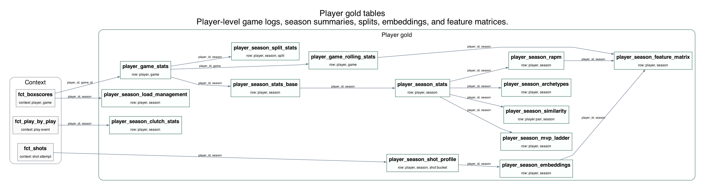
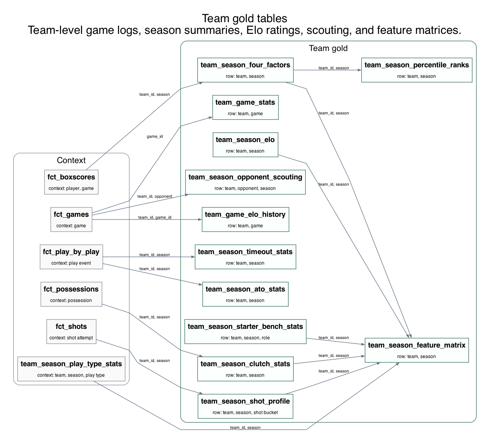
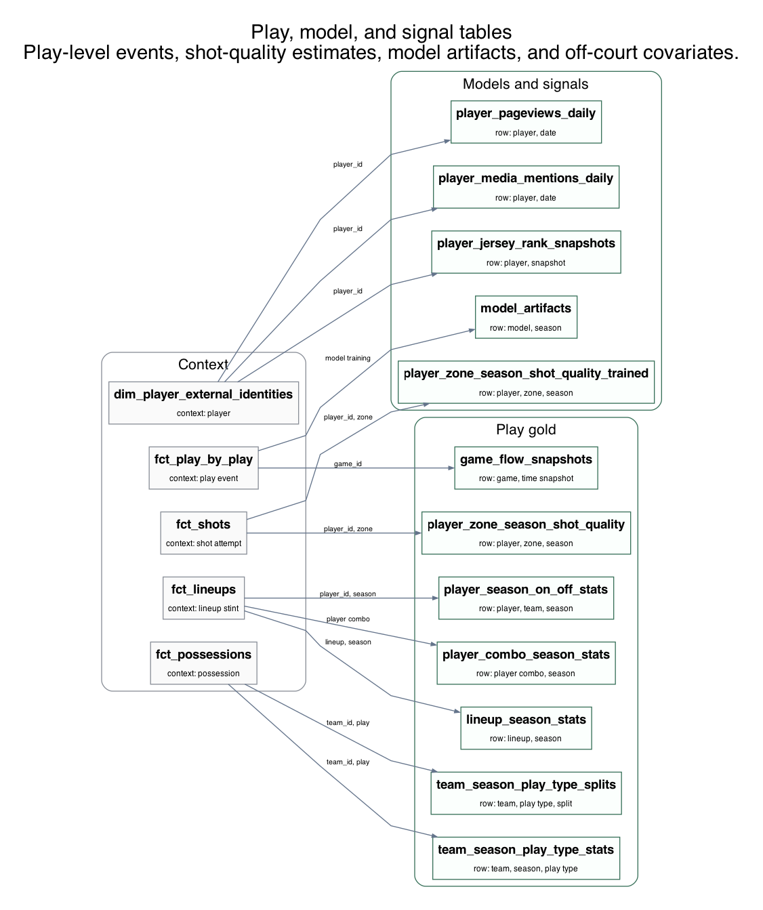

# Warehouse Diagrams

The README shows the raw source and silver table map because that is the first
shape most readers need. The rest of the warehouse is too large for one readable
image, so these views split it by how someone would usually query it.

Every bronze, silver, and gold table appears as a primary table in exactly one
diagram. Some upstream tables repeat as context so the individual views are
easier to read. Diagram generation checks each table against the schema and
checks curated relationships against the dbt manifest plus Python task
metadata. If the manifest is missing or stale, `make diagrams` and
`make check-diagrams` may run `dbt parse` and refresh ignored files under
`dbt/target/`.

Implementation note: some bronze tables are raw source tables, not transform
inputs. For example, the pipeline stores `bronze.tracking`, while
`silver.fct_tracking` is built from `bronze.tracking_stats`.

For the full generated graph, run:

```bash
uv run nba-duckdb datasets graph --format html --output data/lineage.html
```

Regenerating the PNG files with `make diagrams` requires Graphviz.

## Bronze to silver

Raw NBA source records and derived silver facts and dimensions.


## Player gold tables

Player-level game logs, season summaries, splits, embeddings, and feature matrices.



## Team gold tables

Team-level game logs, season summaries, Elo ratings, scouting, and feature matrices.



## Play, model, and signal tables

Play-level events, shot-quality estimates, model artifacts, and off-court covariates.


