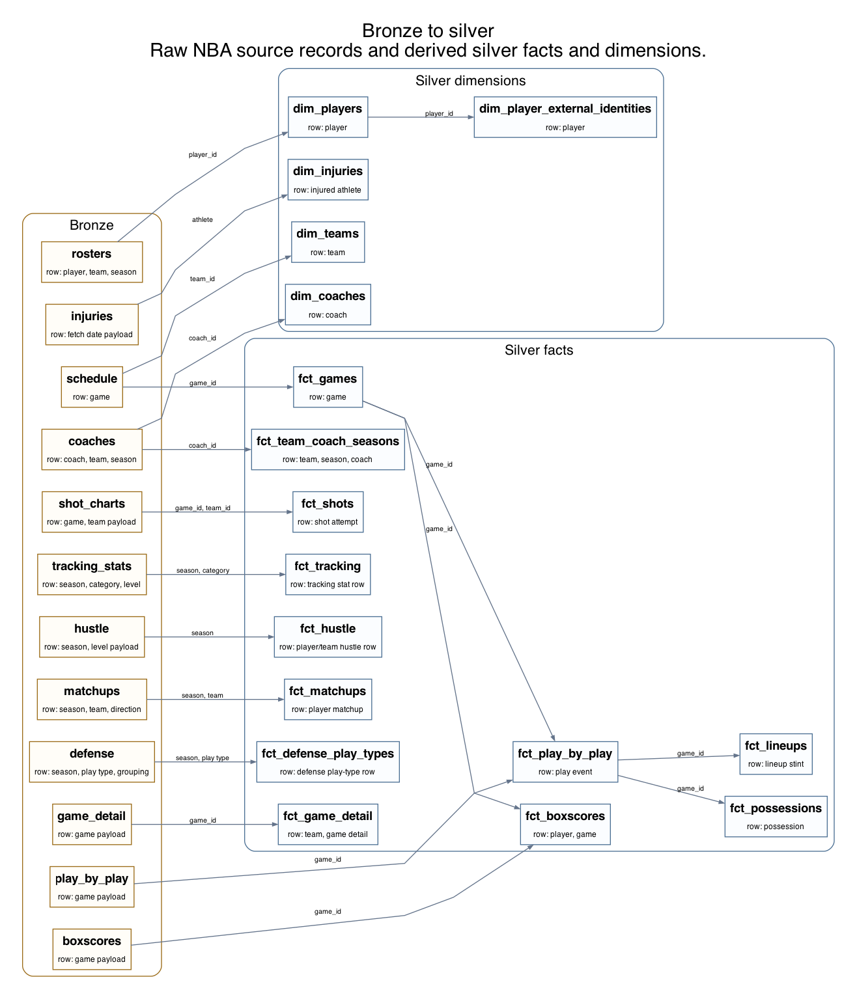
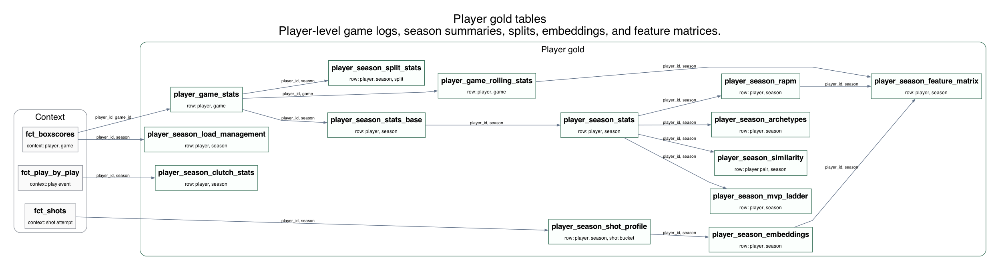
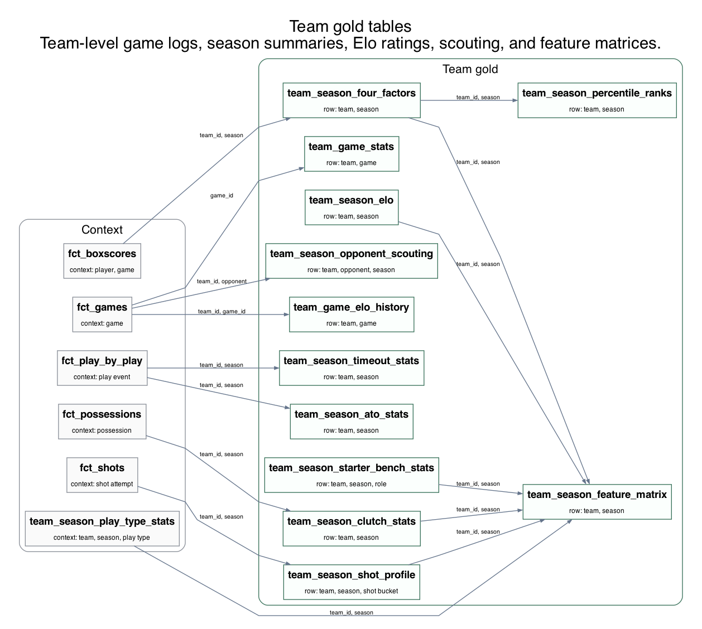
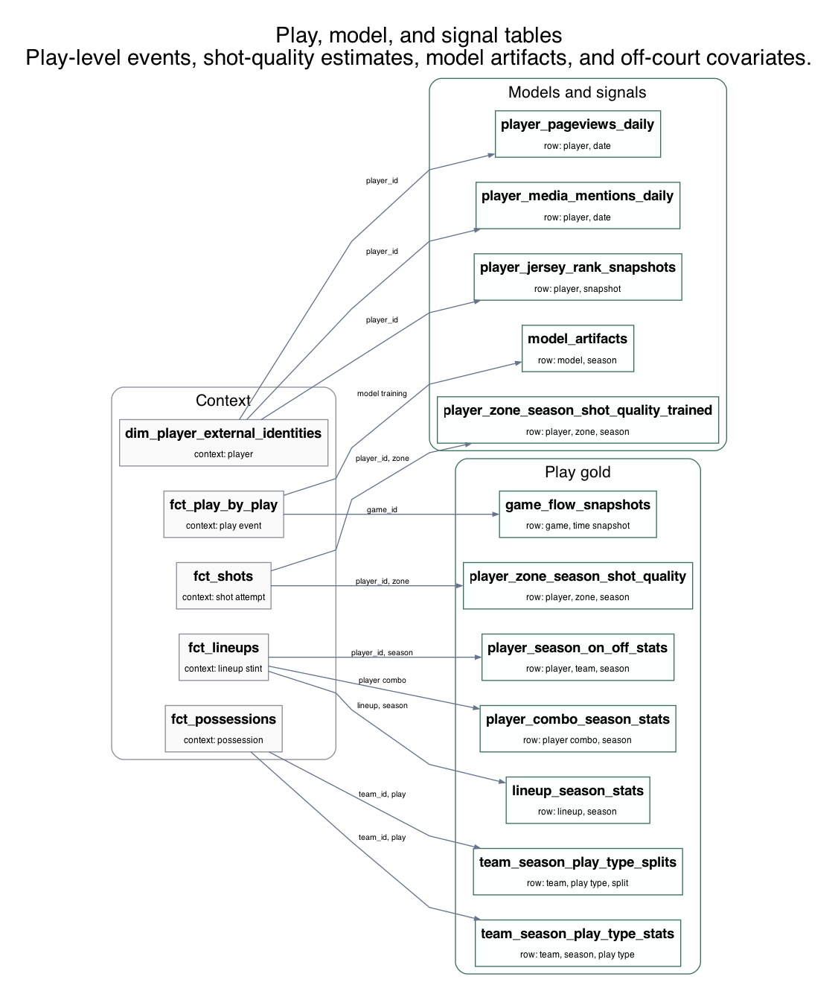

# Table diagrams

The warehouse is too big for one picture, so it's split into four. Every table
shows up as the main table in exactly one of them; a few upstream tables repeat
for context.

`make diagrams` regenerates the PNGs (you'll need Graphviz) and checks them
against the dbt manifest and the task registry. For the full graph in your
browser:

    uv run nba-duckdb datasets graph --format html --output data/lineage.html

## Bronze to silver

## Player tables

Game logs, season stats, splits, embeddings and the feature matrix.

## Team tables

Game logs, season stats, Elo, scouting and the feature matrix.

## Plays, models and signals

Play-by-play events, shot quality, model artifacts, and off-court signals like
page views and media mentions.

