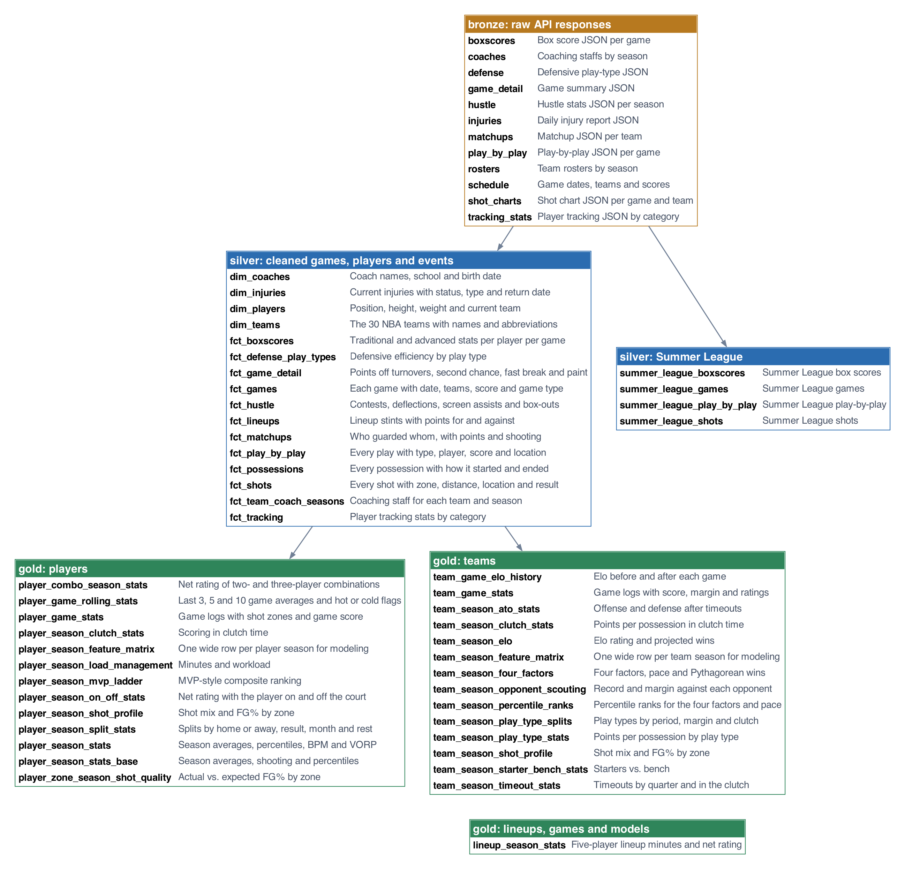
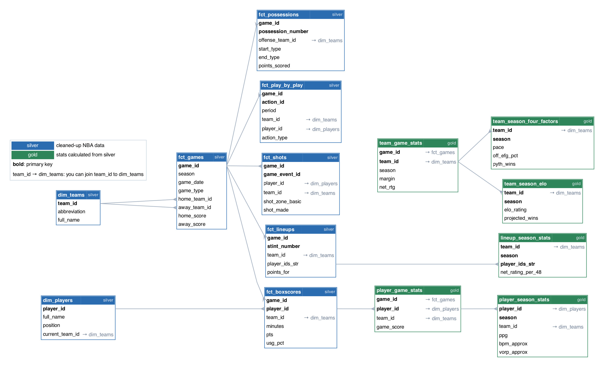
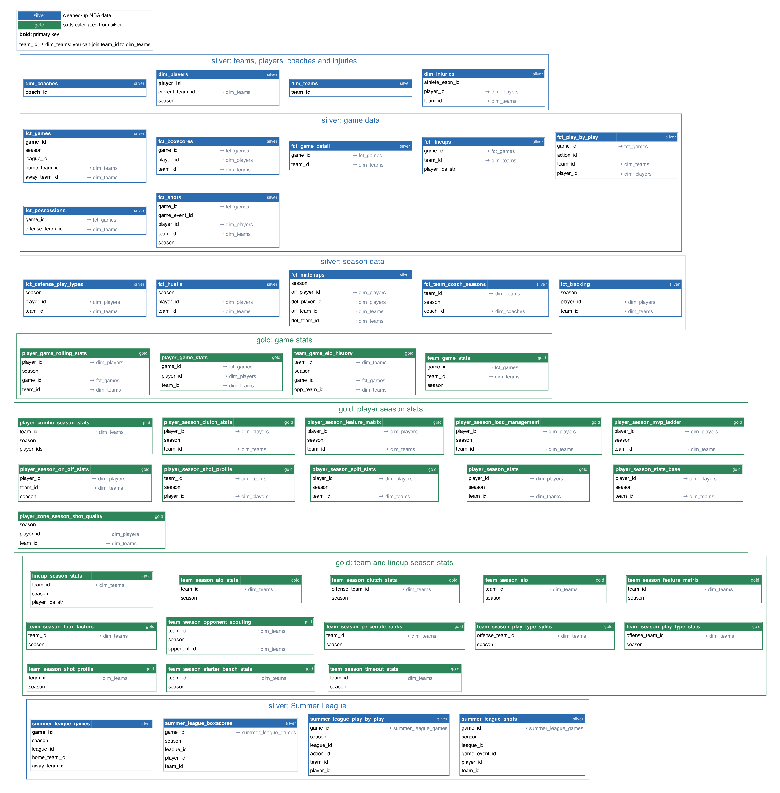

# Tables

Every table in the database, grouped by layer:

## Core tables

## All tables

All silver and gold tables with key columns. Bronze tables are excluded because they only contain raw API responses.

## Notes

- Silver tables include every game type (preseason, regular season, All-Star, playoffs, play-in and NBA Cup), which you can find in `fct_games.game_type`. Gold tables only count regular-season games.
- `fct_games.is_neutral` marks games where neither team is at home, such as NBA Cup games in Las Vegas and games abroad. They count in every stat except home/away splits, and `team_game_elo_history.is_home` is empty for them.
- `player_season_stats` has one row per player per season, so a traded player is listed under the team they played the most games for, counting only games they got into. A tie goes to the team they played for last.
- In `player_season_stats`, `avg_usg_pct` is season usage as a fraction (0.25 means 25%), worked out from the player's season totals and their team's totals in the games they played, as Basketball-Reference does. Team turnovers come from play-by-play, so it is NULL if any of those games has no play-by-play.
- In `player_season_stats`, `bpm_approx`, `obpm`, `dbpm` and `vorp_approx` are Basketball-Reference's Box Plus/Minus 2.0 and VORP, worked out from season totals rather than summed game by game as they do, which is why the names keep `_approx`. A traded player's BPM covers all his teams, weighted by minutes. They are NULL for a season where any game has no play-by-play, since team turnovers and the average lead come from it, and for a partial load whose games can't separate each team's offense from its defense (two teams that only play each other, say).
- `team_game_stats.avg_lead` is the team's average lead over the game clock (its score minus the opponent's, weighted by how long each score stood). It is NULL for a game with no play-by-play.
- `fg_shoot_pct` and `fg3_shoot_pct` only rank players with at least 100 attempts (FGA or 3PA) in the season, and are NULL below that, the same way `avg_ts_pct` needs 20 shots and free throws. At 100 attempts, chance alone moves a shooting percentage by about 5 points (one standard deviation), which is about how far FG% varies between regular players.
- In `player_game_rolling_stats`, `is_hot` and `is_cold` compare the last 5 games with the last 20 against the spread of game score over the season so far, never later games. Both are NULL for a player's first game.
- `fct_lineups.player_ids_str` holds the ids of the players on the floor, sorted and separated by commas.
- Summer League tables only join to `summer_league_games`, since their player and team ids haven't been checked against `dim_players` and `dim_teams` yet.

To redraw the diagrams, run `make smoke` and then `make diagrams`. CI will fail if they're out of date.
